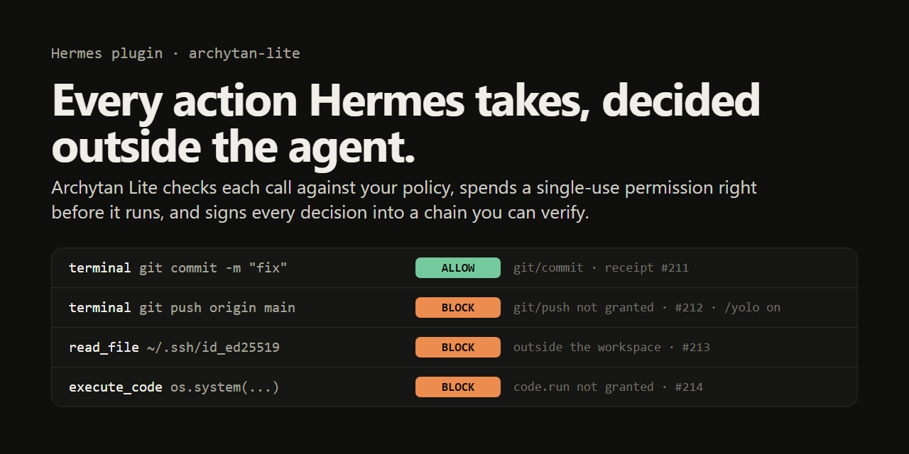

# Archytan Lite for Hermes



A Hermes plugin that puts every tool call in front of
[Archytan Lite](https://high-archy.tech/lite), an authorization gate that
runs outside Hermes with its own signing key. Hermes asks, the gate
decides, and only an ALLOW lets the tool run. Every decision, allowed or
refused, becomes an Ed25519-signed, hash-chained receipt that you can check
later without trusting Hermes or this plugin.

```
Hermes wants to run:   terminal  git push origin main
Plugin asks the gate:  shell.run on git/push
Archytan Lite:         BLOCK  (receipt #212, trace trc_7f3a...)
Hermes sees:           Archytan Lite refused this call: shell.run on git/push
                       (the policy doesn't allow it). Nothing ran. ...
```

## Why a gate outside the agent

Hermes already has approvals, and they're good at asking a person. They're
also something a session can switch off: `/yolo`, `--yolo`,
`approvals.mode: off` and unattended runs all skip them. A guard that lives
inside the agent process shares its fate with the agent.

This plugin moves the decision somewhere else:

- **The decision is made by a separate process.** The gate holds the
  policy and the signing key. The agent can't edit either: both live
  outside the workspace it's allowed to write, and the plugin checks file
  writes, shell redirects and the paths commands name before anything runs.
- **A refusal holds under /yolo.** The plugin returns Hermes's `block`
  directive, which YOLO and `approvals.mode: off` don't bypass. Tested
  that way (see [Tests](#tests)).
- **One ALLOW, one call.** Each ALLOW carries a single-use capability. The
  plugin spends it right before the tool runs, and the gate refuses to let
  it be spent twice. A call with several checks (a command that runs two
  programs and writes a file) is refused unless every check is allowed, and
  nothing is spent until all of them are.
- **Fail closed.** No answer from the gate, a bad signature, a receipt that
  doesn't match the request, a missing setting or an error inside the
  plugin all refuse the call.
- **A record you can check.** `hermes archytan verify` checks every
  receipt's signature and the chain linking it to the one before, and
  names the exact receipt where anything was edited, reordered or removed.
- **Policy you can read.** One JSON file. Edit it and run
  `hermes archytan reload`; the gate validates the new file before using
  it and keeps the old one if the new one is invalid. Each receipt records
  the hash of the policy it was decided under.

## Quick start

You need Hermes 0.22.6 or later and Docker.

```sh
# 1. Install and enable the plugin
hermes plugins install High-ArchyTech-Solutions/hermes-archytan-lite/archytan-lite --enable

# 2. Pull the gate image yourself (Archytan Lite 2.7.1, pinned by digest)
docker pull ghcr.io/high-archytech-solutions/archytan-lite@sha256:205703a7fc67a9e96aa0930fd9dda83fe2b9694b724b13dea8c1854948e82071

# 3. Start the gate for one project folder
hermes archytan setup --workspace /path/to/your/project
```

Setup generates the gate's signing key, issues Hermes its own credential
(role `hermes_agent`), writes the starter policy for that folder, starts
the gate on `127.0.0.1:8431`, stores the settings and runs two checks: a
read inside the folder must come back ALLOW and one outside it BLOCK.
Restart the gateway afterwards so running sessions pick it up.

If Hermes runs commands in a container (`terminal.backend: docker` and
similar), give the workspace as the path inside the container and say what
`~` means there:

```sh
hermes archytan setup --in-container --workspace /workspace/project --home /root
```

Until setup has run, the plugin refuses every gated tool call. That's
deliberate: an installed gate that quietly lets things through is worse
than none.

Then, in any chat:

```
/archytan            gate status and today's decisions
/archytan log 20     the last 20 decisions
/archytan verify     check every receipt
```

## What gets checked

Each tool call becomes one or more checks: an action and a resource. All
of them must be allowed.

| Hermes tool | Action | Resource |
|---|---|---|
| `read_file`, `search_files` | `file.read` | the absolute path |
| `write_file`, `patch` | `file.write` | the absolute path; for a multi-file V4A patch, every file it adds, updates, deletes or moves to |
| `terminal` | `shell.run` | each program, as `git/push` for tools with subcommands |
| | `file.read` / `file.write` | every path a command names, its redirects, its working directory |
| | `web.fetch` | every URL a command names |
| | `shell.env` | each `NAME=value` set in front of a command |
| `web_extract` | `web.fetch` | `https/host` for each URL |
| `web_search` | `web.search` | `web` |
| `vision_analyze`, `video_analyze` | `file.read` or `web.fetch` | the file or the host |
| `execute_code` | `code.run` | `python` |
| `browser_*` | `browser.use` | the tool |
| `memory` | `memory.write` | the store |
| `skill_manage` | `skill.write` | `skills` |
| `cronjob_manage` | `cron.manage` | the operation (`create`, `list`, ...) |
| `delegate_task` | `agent.delegate` | `subagent` |
| `image_generate`, `text_to_speech`, ... | `media.generate` | the tool, plus `file.write` on any `output_path` |
| `kanban_*` writes | `kanban.write` | the tool |
| MCP tools (`mcp_*`) | `mcp.call` | the tool name |
| `manage_catalog`, `manage_connections` | `hermes.admin` | the tool |
| anything else | `tool.call` | the tool name |

Writes inside a `.git` folder also need `repo.internal`, because a hook or
a config line there is a command git runs later.

Relative paths resolve against the workspace, and the plugin hands the
resolved path back to the tool, so the path that was checked is the path
that's used. Every terminal command runs in the directory it was checked
in. A few tools that only read Hermes's own state or talk to you (`clarify`,
`todo_list`, `skill_view`, `session_search` and similar) skip the gate;
the list is the `ungated_tools` setting.

### How commands are read

The plugin reads each command the way a POSIX shell would (Hermes runs
commands in bash, Git Bash on Windows): quotes, escapes, `;`, `&&`, `||`,
pipes, redirects, `cd dir &&` at the start, globs. When a command's meaning
is only settled when the shell runs it, it's refused as
`unreadable-command`: `$VAR`, `$(...)`, backticks, here-documents, process
substitution, brace expansion, loops, a `cd` part-way through. The message
tells the agent to write it plainly, and it usually does.

## The starter policy

Deliberately tight. Hermes can:

- read and write inside the workspace;
- run `ls pwd cat head tail wc grep rg sort uniq diff echo printf date true
  false which file stat du tree mkdir touch cp mv`, and `git status diff log
  show branch add commit switch fetch rev-parse`;
- search the web and fetch `https` pages;
- keep memory, delegate to subagents (they run in the same process, behind
  the same gate), generate media, list cron jobs.

Everything else is refused until you add it, including deleting files,
`git push`, running code (`python`, `node`, `execute_code`), the browser,
MCP servers, other plugins' tools, new cron jobs, editing skills and kanban
tasks (a kanban task is picked up by another profile's worker, and that
profile may not run this plugin). Rate limits stop a looping agent: 60
commands, 120 file writes and 30 searches a minute.

None of the starter programs runs code it's handed. `find` (`-exec`),
`xargs`, `sed`, `awk` and every interpreter are left out because each can.

## Changing the policy

```sh
hermes archytan policy     # prints the path
# edit it, then:
hermes archytan reload
```

To let Hermes push feature branches and run your tests, add `git/push` and
`pytest` to the `shell.run` grant:

```json
{ "action": "shell.run",
  "grants": [{ "roles": ["hermes_agent"],
               "resource_ids": ["ls", "cat", "git/status", "git/push", "pytest"] }] }
```

A pattern can use `*` inside one path segment and `**` at the end
(`/srv/reports/**`). An action that isn't in the file is refused for every
role. The format is documented in the
[Archytan Lite README](https://github.com/High-ArchyTech-Solutions/archytan-lite-community#your-own-policy)
and has a [JSON Schema](https://high-archy.tech/schemas/policy.v1.json).

Granting an interpreter (`python`, `node`, `bash`) grants everything it can
do. The gate sees which program runs, not what the program does.

## What this doesn't do

Be clear about these before relying on it:

- **It decides what Hermes asks for, not what programs do.** A granted
  program can do anything it's capable of. Keep the program list short.
- **Paths are checked as written, then resolved.** Symlinks are followed
  when the workspace is on this machine. In a container workspace (paths
  the host doesn't have) the check is lexical, so a symlink inside the
  workspace that points out of it isn't caught there.
- **A command's bare file names are assumed to be in its working
  directory**, which is checked. A program that opens other files on its
  own (a config file it reads by default) isn't seen.
- **Other plugins can change arguments.** Hermes merges every plugin's
  `modify` result. A plugin that rewrites a path after this one checked it
  would make the tool act on something unchecked. Don't combine this with
  plugins that rewrite tool arguments.
- **It needs Hermes's default in-process plugins.** Under
  `plugins.isolation: host` the `hermes archytan` commands aren't
  available.
- **The gate runs on the same machine.** Someone with your account can stop
  it (then every gated call is refused) or replace its policy. The receipts
  still show what was decided before that, and the chain shows if any were
  changed.

## Disclosure

- **The gate is a separate program.** Archytan Lite is proprietary
  software by High ArchyTech Solutions (the maintainer of this plugin),
  free to run under its
  [Community license](https://github.com/High-ArchyTech-Solutions/archytan-lite-community/blob/main/ARCHYTAN-LITE-LICENSE.txt).
  It runs from the image
  `ghcr.io/high-archytech-solutions/archytan-lite@sha256:205703a7fc67a9e96aa0930fd9dda83fe2b9694b724b13dea8c1854948e82071`
  (2.7.1, linux/amd64 and linux/arm64), which the plugin never pulls on its
  own: you pull it, or pass `--pull` to setup. Its public home, release
  notes and schemas are
  [archytan-lite-community](https://github.com/High-ArchyTech-Solutions/archytan-lite-community).
- **Network:** the hook sends every gated tool call's action and resource
  (a path, a program name, a host, a tool name) and an actor id
  (`hermes:<session id>`) to the gate's URL, `http://127.0.0.1:8431` by
  default. Never tool arguments' contents, file contents or results.
  Nothing goes anywhere else. Neither the plugin nor the gate has
  telemetry.
- **Shell and Docker:** only `hermes archytan` commands and `/archytan
  verify` run anything: `docker` with a minimal environment (PATH, HOME and
  Docker's own variables). Setup creates the volume `archytan-hermes-data`
  (signing key and receipt log) and the container `archytan-hermes`
  (restart policy `unless-stopped`, port bound to 127.0.0.1), and runs the
  image's `keygen`, `callergen` and `policylint`.
- **Files:** under `<HERMES_HOME>/plugin-data/archytan-lite/`: the policy
  and callers files the gate reads, the gate's public key, and
  `decisions.jsonl`, a local list of recent decisions (tool, action,
  resource, decision, trace id; about 2 MB at most).
- **Credentials:** setup stores Hermes's caller token through Hermes's own
  credential store as `ARCHYTAN_LITE_HERMES_TOKEN`, and the plugin reads it
  with `get_secret`. The callers file holds only the token's SHA-256.
- **Approvals:** the plugin only ever blocks or lets a call continue. It
  never approves anything on Hermes's behalf.

## Tests

```sh
python -m venv .venv && .venv/bin/pip install "archytan-lite==2.1.1" pytest
.venv/bin/python -m pytest tests
```

The live tests start throwaway gates from the pinned image (pull it first):
real ALLOW and BLOCK decisions, a wrong public key, a wrong token, an
unreachable gate, a gate without capabilities, an unexpected policy hash,
rate limits, a policy reload changing both the decision and the signed
policy hash, and a receipt edited in the database being caught by
`--verify-chain`. `tests/test_in_hermes.py` installs the plugin into a
throwaway `HERMES_HOME`, loads it with Hermes's own plugin manager and sends
tool calls through Hermes's dispatcher with `--yolo` on and approvals off:
refused calls don't run, allowed ones run where they were checked. Run it
with `scripts/test-in-hermes.sh /path/to/hermes-agent`.

## License

MIT. The plugin calls the gate through the
[official Python client](https://pypi.org/project/archytan-lite/), also MIT.
